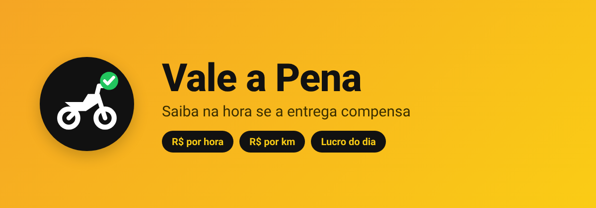
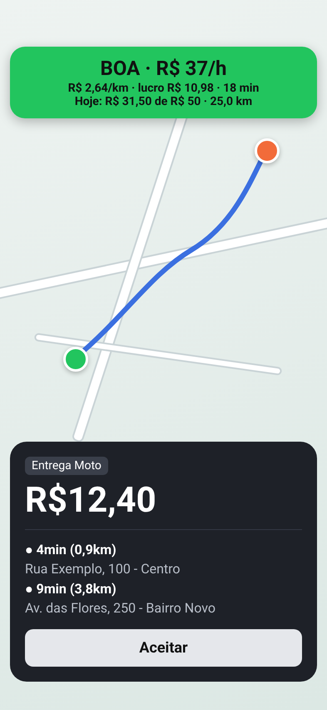
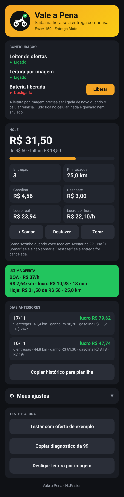

# Vale a Pena

App Android que avisa **na hora** se uma oferta de entrega ou corrida de moto compensa.

Quando a oferta aparece, ele lê o valor e os km, faz a conta com os gastos da sua moto e mostra uma faixa colorida no topo da tela. Ele também fala o resultado em voz alta.

## ⬇️ Baixar

### [👉 Baixar o Vale a Pena (.apk)](https://github.com/HigorPrudencio/vale-a-pena/releases/latest/download/ValeAPena.apk)

Abra o link no celular Android. O download começa sozinho. Esse link sempre baixa a versão mais nova.

## Como ele avisa

| A faixa na oferta | A tela do app |
|---|---|
|  |  |

- 🟢 **BOA:** bate a sua meta de lucro por hora
- 🟡 **MAIS OU MENOS:** fica perto da meta (80% ou mais)
- 🔴 **RECUSA:** paga pouco por hora, paga menos de R$ 1 por km, ou dá prejuízo
- ⚠️ **Entrega longe:** avisa quando o destino passa de 10 km, porque você pode voltar vazio

## O que ele calcula

- **Lucro real:** valor da oferta menos gasolina e desgaste da moto
- **R$ por hora:** conta o tempo da oferta mais um tempo extra pra estacionar, esperar e entregar
- **R$ por km:** soma os km até a coleta com os km da entrega
- **Resumo do dia:** entregas, km, gasolina, desgaste, lucro e lucro por hora
- **Histórico:** guarda 90 dias e copia tudo pra colar no Google Planilhas

Os valores padrão são de uma Yamaha Fazer 150 (35 km/l, gasolina R$ 6,39, meta de R$ 25 por hora). Dá pra mudar tudo em **Meus ajustes**.

## Instalar

1. Baixe o `ValeAPena.apk` pelo link acima
2. Toque no arquivo. Se o Android pedir, permita **instalar apps desta fonte**.
3. Se o **Play Protect** bloquear: abra a Play Store, toque na sua foto, entre em **Play Protect**, toque na engrenagem e desligue **Verificar apps**. Instale e **ligue de novo** depois.

O Play Protect bloqueia porque o app não está na Play Store e lê a tela. O código está todo aqui, aberto.

## Configurar (só na primeira vez)

Abra o app e ligue os 3 itens do quadro **Configuração**:

1. **Leitor de ofertas:** toque em **Ativar**, entre em "Vale a Pena: leitor de ofertas" e ative
2. **Leitura por imagem:** toque em **Ligar** e depois em **Iniciar agora**
3. **Bateria liberada:** toque em **Liberar** e escolha **Não otimizar**

Pronto. Fique online no app de entregas e trabalhe normalmente. Se o celular reiniciar, ligue a **leitura por imagem** de novo.

## Apps de banco

Alguns apps de banco bloqueiam o celular quando acham um app de fora da Play Store que lê a tela. Isso é uma proteção contra golpes, porque apps falsos usam esse mesmo recurso pra roubar senhas.

**Antes de abrir o banco:**
1. Abra o Vale a Pena e toque em **⏸ Pausar tudo para usar o banco**
2. Use o banco normalmente
3. Depois, volte no Vale a Pena e toque em **Ativar** e **Ligar** de novo

Se o banco continuar bloqueando mesmo com o app pausado, a única saída é desinstalar o Vale a Pena desse celular.

## Privacidade

- Tudo roda **dentro do seu celular**
- A imagem da tela é lida na hora e apagada. Nada é gravado nem enviado pra internet.
- O app **não aceita nem recusa** nada sozinho. Quem decide é você.

## Atualizar

Baixe pelo mesmo link e instale por cima. Seus ajustes e o histórico continuam salvos.

---

Feito por **H.JVision**. App independente, sem nenhuma ligação com a 99 ou outras plataformas de entrega.
